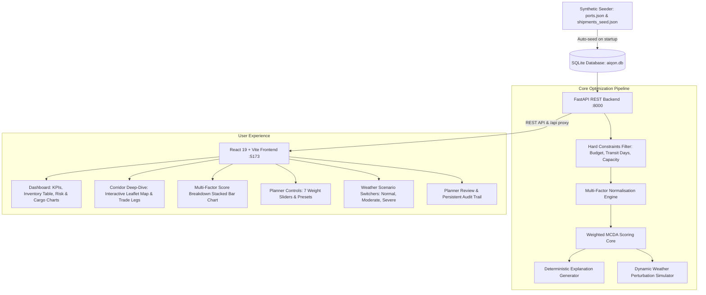

# RouteWise — AI-Powered Shipment Route Optimisation System

[](https://fastapi.tiangolo.com)
[](https://www.python.org/)
[](https://react.dev/)
[](https://vitejs.dev/)
[](https://tailwindcss.com/)
[](https://leafletjs.com/)
[](LICENSE)

An intelligent decision-support system built for logistics planners and freight forwarders to evaluate multi-factor trade-offs across global maritime and multimodal shipping corridors.

---

## 1. Project Overview

Global container shipping is volatile. Ocean freight planners face competing operational priorities:
- **Cost minimization** vs. **Transit speed**
- **Port congestion** at major transshipment hubs (Singapore, Colombo, Port Klang)
- **Severe weather disruptions** (typhoons and cyclones in the Bay of Bengal and South China Sea)
- **Geopolitical chokepoint vulnerabilities** (Red Sea / Suez Canal, Strait of Malacca)
- **Decarbonization mandates** (IMO greenhouse gas emissions reduction targets)

**RouteWise** delivers an automated, transparent route evaluation engine. Rather than acting as an opaque "black-box" or booking freight autonomously, the platform calculates quantitative suitability scores across all eligible routes, presents clear mathematical trade-off rationales, and supports human-in-the-loop (HITL) approval or override workflows.

---

## 2. Architecture & Data Flow



---

## 3. Technology Stack

### Backend
- **Python 3.12**: Core programming language.
- **FastAPI**: Asynchronous web framework with automatic OpenAPI documentation.
- **SQLAlchemy**: Object-Relational Mapping (ORM) and session management.
- **SQLite**: Local, serverless relational database.
- **Pydantic v2**: Strict input validation and serialization schemas.
- **Pytest & HTTPX**: Comprehensive automated testing framework.

### Frontend
- **React 19**: Modern component architecture utilizing hooks (`useState`, `useEffect`, `useMemo`).
- **Vite 8**: Rapid build tool with Hot Module Replacement (HMR) and production bundling.
- **Tailwind CSS 3**: Custom dark-mode logistics theme design system.
- **React-Leaflet & Leaflet 1.9**: Interactive GIS mapping of global ports and trade corridors using standard OpenStreetMap tiles.
- **Recharts**: Responsive data visualization (donut risk charts, commodity distribution bars, and stacked factor score charts).
- **Axios**: Centralized API client with safe payload handling.
- **React Router v7**: Client-side single-page application routing.

---

## 4. Multi-Factor Scoring Algorithm

RouteWise implements a deterministic **Multi-Criteria Decision Analysis (MCDA)** model evaluated over 7 weighted factors:

### 4.1 Normalisation Formula (Lower-is-Better)
For every metric $v$ across all eligible routes for a given shipment:
$$\text{Normalised Score} = 1.0 - \frac{v - v_{\min}}{v_{\max} - v_{\min}}$$

- **1.0**: Best raw value among compared routes.
- **0.0**: Worst raw value among compared routes.
- If all route options have equal values, all routes receive $1.0$ for that factor.

### 4.2 Preference Presets & Default Weights

| Factor | Balanced | Lowest Cost | Fastest | Lowest Risk |
| :--- | :---: | :---: | :---: | :---: |
| **Cost** | 28% | 50% | 10% | 10% |
| **Transit Time** | 22% | 10% | 50% | 10% |
| **Delay Probability** | 18% | 15% | 20% | 25% |
| **Port Congestion Risk** | 12% | 10% | 8% | 20% |
| **Geopolitical Risk** | 12% | 8% | 8% | 20% |
| **Weather Risk** | 5% | 5% | 3% | 12% |
| **Carbon Emissions** | 3% | 2% | 1% | 3% |
| **Total** | **100%** | **100%** | **100%** | **100%** |

### 4.3 Composite Suitability Score
$$\text{Suitability Score} = \sum_{i=1}^{7} \left( w_i \times \text{Normalised Score}_i \right) \times 100$$

### 4.4 Overall Route Risk Calculation
$$\text{Overall Risk} = (0.35 \times \text{Delay Prob}) + (0.30 \times \text{Congestion}) + (0.20 \times \text{Geopolitics}) + (0.15 \times \text{Weather})$$
- **Low Risk**: $0.0 \le \text{Risk} < 30.0$
- **Moderate Risk**: $30.0 \le \text{Risk} < 60.0$
- **High Risk**: $\text{Risk} \ge 60.0$

---

## 5. Key Application Features

1. **Planner Surveillance Dashboard**:
   - 4 live KPI cards tracking Total Active Shipments, Under Review count, Average Delay Probability, and High Risk corridors.
   - Dynamic route count derived from real-time API statistics.
   - Instant search across shipment IDs, port codes, and cargo commodities.
   - Status (`Under Review`, `Approved`, `Alternate Selected`) and Priority filters.
   - Recharts global risk distribution donut chart and cargo volume breakdown.

2. **Maritime Trade Corridor Mapping**:
   - Interactive OpenStreetMap integration with automatic bound fitting.
   - Visual distinction between Recommended route (green), Selected route (sky blue), and Alternate routes (slate).
   - Port waypoint markers displaying port names, UN/LOCODEs, coordinates, and types.

3. **Multi-Factor Score Breakdown Chart**:
   - Stacked horizontal Recharts bar chart showing exact point contributions from all 7 factors out of 100 points.

4. **Interactive Optimization Controls**:
   - 4 one-click preference presets.
   - 7 independent weight sliders with real-time 100% total validation.
   - Hard constraints (Maximum Cost USD, Maximum Transit Days, and Constrained Capacity exclusion toggle).

5. **Weather Disruption Simulation**:
   - Three meteorological scenarios: **Normal**, **Moderate Storm**, and **Severe Cyclone**.
   - Applies targeted delay and risk vectors to specific sea zones (Bay of Bengal, South China Sea, Malacca Strait) in-memory without corrupting baseline database records.

6. **Planner Governance & Audit Trail**:
   - Human-in-the-loop review form: Approve recommendation or select an alternate route with required justification notes.
   - Persistent audit log tracking decision records, timestamps, and justification notes in SQLite.

---

## 6. Synthetic Data & Limitations Disclosure

> [!NOTE]
> **Prototype Demonstration Notice:**
> - All shipment records, global ports, schedules, cost structures, transit times, weather conditions, and risk indexes are **synthetic samples** curated for demonstration and algorithmic validation.
> - Route corridors represent illustrative navigational paths and are not certified commercial vessel tracks.
> - Operational shipping decisions require verification by licensed freight dispatchers.

---

## 7. Windows Setup Instructions

### Prerequisites
- **Python 3.10+** (Python 3.12 recommended): [Download Python](https://www.python.org/downloads/)
- **Node.js 18+** (Node.js 20+ recommended): [Download Node.js](https://nodejs.org/)
- **Git**: [Download Git](https://git-scm.com/)

---

### Step 1: Clone the Repository
```powershell
git clone https://github.com/mohithreddy123-hub/RouteWise.git
cd RouteWise\aiqon-route-optimisation
```

---

### Step 2: Backend Setup (Python + FastAPI)

1. Open PowerShell and navigate to the backend folder:
   ```powershell
   cd backend
   ```

2. Create and activate a Python virtual environment:
   ```powershell
   python -m venv venv
   .\venv\Scripts\activate
   ```

3. Install required Python dependencies:
   ```powershell
   pip install -r requirements.txt
   ```

4. Start the backend API server:
   ```powershell
   uvicorn app.main:app --reload --port 8000
   ```
   *The database (`aiqon.db`) is automatically initialized and seeded on first run.*
   - **Backend API:** [http://localhost:8000](http://localhost:8000)
   - **Interactive API Documentation:** [http://localhost:8000/docs](http://localhost:8000/docs)

---

### Step 3: Frontend Setup (React + Vite)

1. Open a **second** PowerShell window and navigate to the frontend folder:
   ```powershell
   cd C:\path\to\RouteWise\aiqon-route-optimisation\frontend
   ```

2. Install Node.js dependencies:
   ```powershell
   npm install
   ```

3. Start the Vite development server:
   ```powershell
   npm run dev
   ```
   - **Web Application:** [http://localhost:5173](http://localhost:5173)

---

## 8. Running Automated Tests & Builds

### Run Backend Tests (76 Tests)
In the backend terminal with the virtual environment activated:
```powershell
pytest -v
```
*Expected result: 76 passed tests in ~0.3s.*

### Run Frontend Production Build
In the frontend terminal:
```powershell
npm run build
```
*Expected result: `✓ built in ~600ms` with 0 errors.*

---

## 9. Project Directory Structure

```text
RouteWise/
├── .gitignore                                 # Root Git ignore rules (DBs, venv, caches, node_modules)
├── README.md                                  # Repository documentation
└── aiqon-route-optimisation/
    ├── PROJECT_AUDIT.md                       # Comprehensive verification audit log
    ├── project details.txt                    # Detailed technical specification
    ├── backend/
    │   ├── requirements.txt                   # Backend dependencies
    │   ├── .env.example                       # Environment variables template
    │   ├── data/
    │   │   ├── ports.json                     # 35 global ports with coordinates
    │   │   └── shipments_seed.json            # 24 shipments and 68 route options
    │   ├── app/
    │   │   ├── database.py                    # SQLAlchemy connection & sessionmaker
    │   │   ├── models.py                      # ORM schemas (Shipment, Route, Leg, Review)
    │   │   ├── schemas.py                     # Pydantic validation schemas
    │   │   ├── seed_data.py                   # Idempotent DB seeder
    │   │   ├── main.py                        # FastAPI entrypoint, CORS & routers
    │   │   ├── routers/                       # REST route handlers
    │   │   └── services/                      # Scoring, Recommendation, Weather & XAI services
    │   └── tests/                             # 76 Pytest unit & integration tests
    └── frontend/
        ├── package.json                       # Frontend packages & scripts
        ├── vite.config.js                     # Vite build & /api dev proxy
        ├── tailwind.config.js                 # Tailwind CSS theme configuration
        ├── postcss.config.js                  # PostCSS plugins
        └── src/
            ├── api.js                         # Centralized Axios API client
            ├── utils.js                       # Display formatters & risk styling
            ├── Dashboard.jsx                  # Surveillance dashboard component
            ├── ShipmentAnalysis.jsx           # Interactive map, scoring chart & review component
            └── App.jsx                        # Application shell & React Router routes
```

---

## 10. License

This project is licensed under the [MIT License](LICENSE).